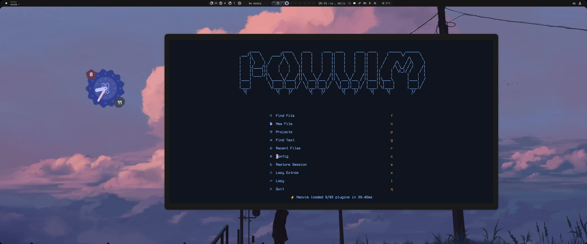
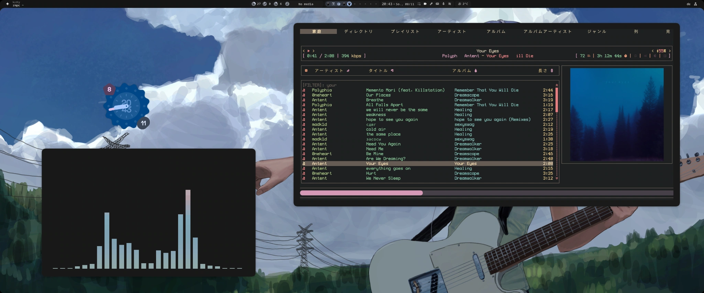

# Linux dotfiles

[English](README.md) · [Deutsch](docs/README.de.md) · [Русский](docs/README.ru.md)

## Neovim

POVVIM is based on LazyVim, with a custom start screen and the Aardvark Ink theme from Recol. Neogit handles Git, and HTML and Markdown files can be previewed live in the browser.



### Install on Linux

Use Neovim **0.11.2 or newer** with LuaJIT, Git, curl, ripgrep (`rg`), `fd`, `fzf`, the Treesitter CLI and a C compiler. A true-color terminal and a Nerd Font help reproduce the look. Package names below are for Arch Linux. Run the shell blocks in Bash, including if your login shell is fish.

```bash
sudo pacman -S --needed neovim git curl ripgrep fd fzf tree-sitter-cli base-devel unzip
git clone https://github.com/povargg/dotfiles.git
cd dotfiles
```

From the repository root, install into a separate `povvim` profile. Neovim keeps that profile’s plugins, state and cache separate. To make the setup your default, back up your current `nvim` config and move the existing `nvim` data, state and cache directories aside first. Then change `profile=povvim` to `profile=nvim` and launch with `nvim` afterward.

```bash
profile=povvim
config_home="${XDG_CONFIG_HOME:-$HOME/.config}"
target="$config_home/$profile"

mkdir -p "$config_home"
if [ -e "$target" ] || [ -L "$target" ]; then
    printf 'Back up the existing config first: %s\n' "$target" >&2
else
    cp -a nvim "$target" && NVIM_APPNAME="$profile" nvim
fi
```

On first launch, lazy.nvim downloads the plugins. Run `:LazyHealth` to check dependencies, `:Lazy restore` to restore the versions recorded in `lazy-lock.json`, and `:LazyExtras` to add language tooling as needed. For later launches of the isolated profile, use `NVIM_APPNAME=povvim nvim` in Bash or `env NVIM_APPNAME=povvim nvim` in fish. [LazyVim installation guide](https://www.lazyvim.org/installation)

## rmpc

The rmpc setup has a custom theme and Japanese tab names. The main view shows the queue next to the album cover, and CAVA has a tab of its own.



### Install on Linux

This configuration uses **rmpc 0.11.0** and a recent MPD installation. Kitty supports the cover-art protocol. For the glyphs shown here, use a Nerd Font and a Japanese-capable fallback such as Noto Sans CJK.

```bash
sudo pacman -S --needed rmpc mpd mpc
```

From the cloned repository, back up any existing rmpc files and copy the config and the theme together. The copy commands prompt before overwriting a file.

```bash
config_home="${XDG_CONFIG_HOME:-$HOME/.config}"
mkdir -p "$config_home/rmpc/themes"
cp -i rmpc/config.ron "$config_home/rmpc/config.ron"
cp -i rmpc/themes/theme.ron "$config_home/rmpc/themes/theme.ron"
```

If MPD is already configured, use your existing server and match its address in `config.ron`. For a fresh local setup on a PipeWire desktop, install the example below. It uses `~/Music` and listens on `127.0.0.1:6600`. Put some music in that directory or edit `music_directory` to match your library before starting MPD.

```bash
mkdir -p "$config_home/mpd/playlists" "$HOME/Music"
cp -i mpd/mpd.conf "$config_home/mpd/mpd.conf"
systemctl --user enable --now mpd.service
mpc -h 127.0.0.1 -p 6600 update
rmpc
```

If MPD was running before you edited its config, restart it with `systemctl --user restart mpd.service` before running `mpc update`. Use an output supported by your installation if you run a different audio stack. [MPD user manual](https://mpd.readthedocs.io/en/stable/user.html) · [rmpc installation guide](https://rmpc.mierak.dev/installation/)

<details>
<summary>Cover art, lyrics and the optional CAVA pane</summary>

- **Cover art:** Leave `album_art.method` on `Auto` and use a graphics-capable terminal like Kitty. Cover art comes from MPD’s music library.
- **Lyrics:** The layout has a lyrics pane. Set `lyrics_dir` in `config.ron` to the location of your `.lrc` files.
- **Integrated spectrum:** Install `cava`, uncomment the optional FIFO output in `mpd.conf` and restart MPD. rmpc reads `/tmp/mpd.fifo` at 44.1 kHz, 16-bit stereo. Keep the PipeWire output enabled for sound.
- **Standalone spectrum:** Copy the [`cava/`](cava/) configuration into your CAVA config directory and launch `cava` in a separate terminal. It uses terminal bars, auto-detected audio input and a blue-to-rose gradient. To match the screenshot, save the original Amekoji palette as `themes/amekoji` in the CAVA config directory and set `theme = 'amekoji'` under `[color]`. [Amekoji palette](https://github.com/atif-1402/omarchy-amekoji-theme/blob/main/cava_theme)

[rmpc configuration](https://rmpc.mierak.dev/configuration/) · [rmpc and CAVA setup](https://rmpc.mierak.dev/configuration/cava/)

</details>

## Other configs

The terminal configs are based on end-4’s dotfiles. [Kitty](kitty/) · [fish](fish/) · [Starship](starship.toml)

There’s also an MPD example for PipeWire and a few CAVA color presets. [MPD](mpd/) · [CAVA](cava/)

[Credits and licenses](THIRD_PARTY.md)
