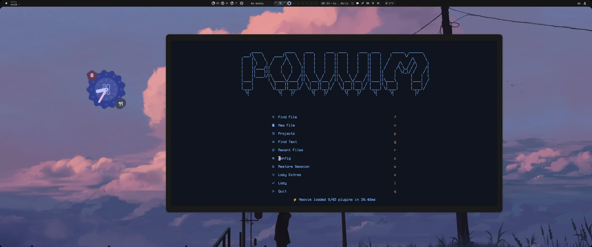
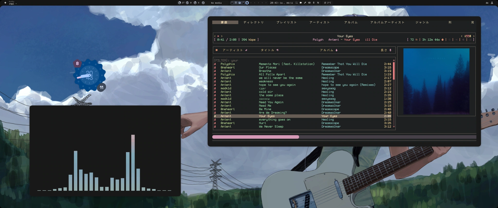
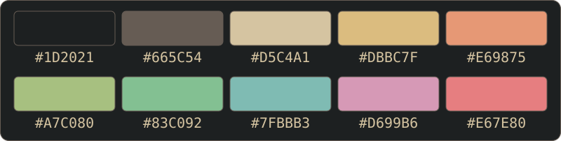

# Linux-Dotfiles

[English](../README.md) · [Deutsch](README.de.md) · [Русский](README.ru.md)

## Neovim

POVVIM basiert auf LazyVim und nutzt Aardvark Ink als Farbschema. Mit Recol lässt sich die Palette direkt in Neovim wechseln.

Änderungen lassen sich mit Neogit direkt im Editor stagen und committen. Zum Vergleichen stellt CodeDiff zwei Dateiversionen nebeneinander. Live Preview aktualisiert beim Bearbeiten von HTML und Markdown die Vorschau im Browser, und Colorizer färbt Hex-Werte im Quelltext ein.

Lange Argumentlisten lassen sich mit TreeSJ auf mehrere Zeilen verteilen und wieder zusammenziehen. Todo Comments hilft bei der Suche nach TODOs und FIXMEs. Compiler startet Build-Aufgaben über Overseer und zeigt die Ausgabe im Editor an.



### Installation unter Linux

Vorausgesetzt sind Neovim **ab 0.11.2** mit LuaJIT, Git, curl, ripgrep (`rg`), `fd`, `fzf`, die Treesitter-CLI und ein C-Compiler. Für die Optik aus dem Screenshot eignen sich ein Terminal mit True Color und eine Nerd Font. Die Paketnamen im Beispiel gelten für Arch Linux. Führe die Befehle in Bash aus. Wenn du fish nutzt, starte dafür zuerst `bash`.

```bash
sudo pacman -S --needed neovim git curl ripgrep fd fzf tree-sitter-cli base-devel unzip
git clone https://github.com/povargg/dotfiles.git
cd dotfiles
```

Installiere das Setup aus dem Repo-Ordner als separates Profil `povvim`. Neovim verwaltet dessen Plugins, Zustand und Cache getrennt. Für eine Installation als Standardprofil sichere zuerst deine bisherige `nvim`-Konfiguration und verschiebe auch die bisherigen Daten-, Zustands- und Cache-Ordner von `nvim`. Setze anschließend `profile=nvim` im folgenden Block und starte den Editor künftig mit `nvim`.

```bash
profile=povvim
config_home="${XDG_CONFIG_HOME:-$HOME/.config}"
target="$config_home/$profile"

mkdir -p "$config_home"
if [ -e "$target" ] || [ -L "$target" ]; then
    printf 'Back up the existing config first: %s\n' "$target" >&2
else
    cp -a nvim "$target" && NVIM_APPNAME="$profile" nvim
fi
```

Beim ersten Start lädt lazy.nvim die Plugins. Mit `:LazyHealth` prüfst du die Abhängigkeiten, mit `:Lazy restore` stellst du die Versionen aus `lazy-lock.json` wieder her und mit `:LazyExtras` kannst du Unterstützung für weitere Sprachen hinzufügen. Später startest du das separate Profil in Bash mit `NVIM_APPNAME=povvim nvim` oder in fish mit `env NVIM_APPNAME=povvim nvim`. [LazyVim-Installationsanleitung](https://www.lazyvim.org/installation)

## rmpc

Warteschlange und Albumcover stehen nebeneinander. Eigene Symbole zeigen den Wiedergabestatus und die Titelbewertungen. Die dunkle Oberfläche hat gedämpfte Grün- und Goldtöne und eine rosa Fortschrittsleiste.





### Installation unter Linux

Das Setup verwendet **rmpc 0.11.0** und eine aktuelle MPD-Installation. Kitty unterstützt die Anzeige von Covern. Für die Symbole und Schrift eignen sich eine Nerd Font und eine Zusatzschrift wie Noto Sans CJK.

```bash
sudo pacman -S --needed rmpc mpd mpc
```

Sichere aus dem geklonten Repo heraus zuerst vorhandene rmpc-Dateien und kopiere dann Konfiguration und Theme gemeinsam. `cp -i` fragt nach, bevor es eine Datei überschreibt.

```bash
config_home="${XDG_CONFIG_HOME:-$HOME/.config}"
mkdir -p "$config_home/rmpc/themes"
cp -i rmpc/config.ron "$config_home/rmpc/config.ron"
cp -i rmpc/themes/theme.ron "$config_home/rmpc/themes/theme.ron"
```

Wenn MPD bereits eingerichtet ist, trage die Adresse deines Servers in `config.ron` ein. Für eine neue lokale Einrichtung mit PipeWire kannst du das folgende Beispiel übernehmen. Es nutzt `~/Music` und hört auf `127.0.0.1:6600`. Lege dort Musik ab oder passe `music_directory` an, bevor du MPD startest.

```bash
mkdir -p "$config_home/mpd/playlists" "$HOME/Music"
cp -i mpd/mpd.conf "$config_home/mpd/mpd.conf"
systemctl --user enable --now mpd.service
mpc -h 127.0.0.1 -p 6600 update
rmpc
```

Falls MPD vor dem Bearbeiten bereits lief, starte den Dienst vor `mpc update` mit `systemctl --user restart mpd.service` neu. Wenn du eine andere Audio-Umgebung nutzt, wähle eine von deinem MPD unterstützte Ausgabe. [MPD-Handbuch](https://mpd.readthedocs.io/en/stable/user.html) · [rmpc-Installationsanleitung](https://rmpc.mierak.dev/installation/)

<details>
<summary>Cover und Liedtexte</summary>

- **Cover:** Lass `album_art.method` auf `Auto` und nutze ein Terminal mit Grafikunterstützung wie Kitty. MPD liefert die Cover aus der Musikbibliothek.
- **Liedtexte:** Trage den Ordner mit deinen `.lrc`-Dateien als `lyrics_dir` in `config.ron` ein.

[rmpc-Konfiguration](https://rmpc.mierak.dev/configuration/)

</details>

## Weitere Konfigurationen

Die Terminal-Konfigurationen basieren auf den Dotfiles von end-4. [Kitty](../kitty/) · [fish](../fish/) · [Starship](../starship.toml)

Für MPD gibt es eine Beispielkonfiguration mit PipeWire und für CAVA ein paar Farbverläufe. [MPD](../mpd/) · [CAVA](../cava/)

<details>
<summary>CAVA einrichten</summary>

- **Separates Spektrum:** Kopiere [`cava/`](../cava/) in deinen CAVA-Konfigurationsordner und starte `cava` in einem eigenen Terminal. Die Konfiguration nutzt Terminalbalken, automatisch erkannte Audioeingabe und einen blau-rosa Verlauf. Für die Farben aus dem Screenshot speichere die Amekoji-Palette als `themes/amekoji` im CAVA-Konfigurationsordner und setze `theme = 'amekoji'` unter `[color]`. [Amekoji-Palette](https://github.com/atif-1402/omarchy-amekoji-theme/blob/main/cava_theme)
- **Integriertes Spektrum:** Installiere `cava`, aktiviere den auskommentierten FIFO-Ausgang in `mpd.conf` und starte MPD neu. rmpc liest `/tmp/mpd.fifo` mit 44,1 kHz, 16 Bit und Stereo. Lass den PipeWire-Ausgang für die Tonwiedergabe aktiv.

[CAVA in rmpc einrichten](https://rmpc.mierak.dev/configuration/cava/)

</details>

[Quellen und Lizenzen](../THIRD_PARTY.md)
