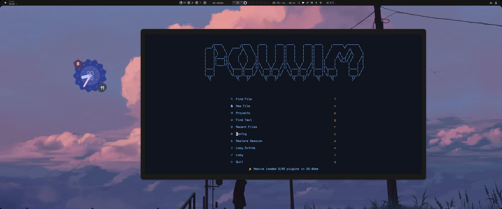
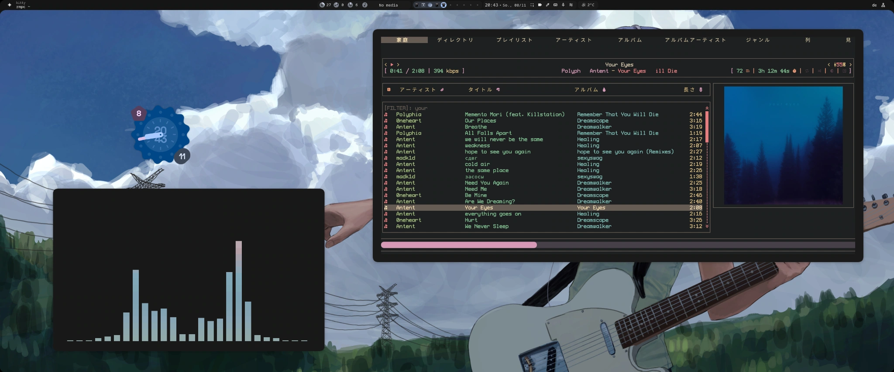

<div align="center">

# Конфигурации для Linux

**POVVIM для разработки. Собственная конфигурация rmpc для музыки.**

[English](../README.md) · [Deutsch](README.de.md) · [Русский](README.ru.md)

[Neovim](#neovim) · [rmpc](#rmpc) · [Структура репозитория](#структура-репозитория) · [Источники](#источники)

</div>

Мои настройки Linux для работы в терминале и прослушивания локальной музыкальной коллекции. POVVIM основан на LazyVim. Интерфейс и тему rmpc я оформил сам. В них есть японские подписи, очередь рядом с обложкой и отдельная вкладка с визуализатором.

## Neovim



### Что входит в конфигурацию

| Область | Настройки |
| --- | --- |
| Внешний вид | Собственный ASCII-логотип **POVVIM** на стартовом экране Snacks. Там же находятся быстрые переходы к файлам, проектам, недавним файлам и восстановлению сессии. Палитра Aardvark Ink встроена в `init.lua`. |
| Редактирование и поиск | LazyVim подключает LSP, Treesitter, автодополнение Blink, форматирование и поиск по файлам и их содержимому. Дополнения для отдельных языков можно включить при необходимости. |
| Предпросмотр | Live Preview открывает HTML, Markdown, AsciiDoc и SVG в браузере и обновляет страницу по мере редактирования. Colorizer подсвечивает цветовые коды в редакторе. |
| Git | `<leader>gg` открывает Neogit. CodeDiff, Telescope и Baleia подключены как зависимости. |
| Код и задачи | TreeSJ объединяет и разделяет блоки кода с учётом синтаксиса. Compiler и закреплённая версия Overseer добавляют меню сборки и запуска, а также окно результатов. Компиляторы и среды выполнения для своего проекта установите отдельно. |
| Комментарии | Comment.nvim переключает комментарии, Todo Comments подсвечивает метки `TODO:` и `FIXME:`, а Comment Divider вставляет разделители. |

### Установка в Linux

Понадобится Neovim **0.11.2 или новее** с LuaJIT, Git, curl, ripgrep (`rg`), `fd`, `fzf`, Treesitter CLI и компилятор C. Для оформления со скриншота пригодятся терминал с поддержкой True Color и Nerd Font. В примере указаны пакеты Arch Linux. Команды рассчитаны на Bash. Если вы используете fish, сначала запустите `bash`.

```bash
sudo pacman -S --needed neovim git curl ripgrep fd fzf tree-sitter-cli base-devel unzip
git clone https://github.com/povargg/dotfiles.git
cd dotfiles
```

Из корня репозитория установите конфигурацию в отдельный профиль `povvim`. У этого профиля свои плагины, состояние и кеш. Чтобы сделать настройки основными, сначала сохраните копию текущей конфигурации `nvim` и переместите её старые каталоги данных, состояния и кеша. Затем укажите `profile=nvim` в следующем блоке и в дальнейшем запускайте редактор командой `nvim`.

```bash
profile=povvim
config_home="${XDG_CONFIG_HOME:-$HOME/.config}"
target="$config_home/$profile"

mkdir -p "$config_home"
if [ -e "$target" ] || [ -L "$target" ]; then
    printf 'Back up the existing config first: %s\n' "$target" >&2
else
    cp -a nvim "$target" && NVIM_APPNAME="$profile" nvim
fi
```

При первом запуске lazy.nvim загрузит плагины. `:LazyHealth` проверяет зависимости, `:Lazy restore` восстанавливает версии из `lazy-lock.json`, а `:LazyExtras` позволяет добавить поддержку нужных языков. Для следующих запусков отдельного профиля используйте `NVIM_APPNAME=povvim nvim` в Bash или `env NVIM_APPNAME=povvim nvim` в fish. [Руководство по установке LazyVim](https://www.lazyvim.org/installation)

### Основные команды

| Клавиши или команда | Действие |
| --- | --- |
| `<Space>gg` или `:Neogit` | Открыть интерфейс Git. |
| `:LivePreview start` | Открыть текущий файл поддерживаемого формата в браузере. |
| `<Space>m`, `<Space>j`, `<Space>s` | Переключить вид блока под курсором, объединить или разделить его. |
| `:CompilerOpen`, `:CompilerToggleResults`, `:CompilerRedo` | Выбрать задачу сборки или запуска, показать или скрыть результаты либо повторить последнюю задачу. |
| `gcc`, `gc` в визуальном режиме | Переключить комментарий строки или выделенных строк. |
| `:TodoQuickFix`, `:CommentDivider` | Показать список помеченных комментариев или вставить разделитель. |
| `<Space>uR` или `:RecolOpen` | Выбрать палитру. Для этого в `PATH` должна быть утилита `recol`. |
| `:RecolReload` | Повторно применить блок темы из `init.lua` этого профиля. |

Встроенная палитра доступна сразу. При выборе палитры Recol обновляет блок между маркерами `recol:start` и `recol:end`, а сочетание клавиш применяет новые цвета. Рабочая конфигурация находится в [`nvim/`](../nvim/). Старые варианты стартового экрана и цветов лежат отдельно от активных плагинов в [`nvim/experiments/`](../nvim/experiments/). [Recol](https://github.com/nlkli/recol)

## rmpc



### Интерфейс и управление

- **Главная · 家庭** отводит очереди 70% ширины. Справа находятся обложка и текст песни. Верхняя панель показывает состояние воспроизведения, битрейт, громкость, длину очереди и режимы воспроизведения. В таблице очереди видны оценка из стикера MPD, исполнитель, название, альбом и длительность.
- **Визуализатор · 見せる** показывает очередь, текст и обложку над встроенным спектром CAVA. Слева на скриншоте запущен CAVA в отдельном терминале.
- **Медиатека** включает каталоги, плейлисты, исполнителей, альбомы, исполнителей альбомов и жанры. Поиск по тегам работает без учёта регистра. В теме сочетаются тёмный фон, тёплые оттенки рамок и розовая полоса прогресса.

| Клавиши | Действие |
| --- | --- |
| `Tab` / `Shift+Tab` | Переключаться между вкладками. |
| От `1` до `7` | Открыть очередь, каталоги, исполнителей, исполнителей альбомов, альбомы, плейлисты или поиск. |
| `j` / `k`, `h` / `l` | Перемещаться по спискам и панелям. |
| `p`, `<` / `>`, `b` / `f` | Приостановить или возобновить воспроизведение, переключить трек или перемотать его. |
| `,` / `.`, `/` | Изменить громкость или открыть фильтр. |
| `Enter`, `C`, `~` | Запустить выбранный трек, перейти к текущему треку или открыть справку. |

### Установка в Linux

Конфигурация рассчитана на **rmpc 0.11.0** и актуальную версию MPD. Kitty поддерживает отображение обложек. Для значков и японских символов используйте Nerd Font и дополнительный шрифт, например Noto Sans CJK.

```bash
sudo pacman -S --needed rmpc mpd mpc
```

Сохраните копии существующих файлов rmpc. Из корня клонированного репозитория скопируйте конфигурацию вместе с темой. Команда `cp -i` спросит перед перезаписью файла.

```bash
config_home="${XDG_CONFIG_HOME:-$HOME/.config}"
mkdir -p "$config_home/rmpc/themes"
cp -i rmpc/config.ron "$config_home/rmpc/config.ron"
cp -i rmpc/themes/theme.ron "$config_home/rmpc/themes/theme.ron"
```

Если MPD уже настроен, укажите адрес вашего сервера в `config.ron`. Для новой локальной установки с PipeWire подойдёт пример ниже. Он использует каталог `~/Music` и адрес `127.0.0.1:6600`. Перед запуском MPD добавьте музыку в этот каталог или укажите другой путь в `music_directory`.

```bash
mkdir -p "$config_home/mpd/playlists" "$HOME/Music"
cp -i mpd/mpd.conf "$config_home/mpd/mpd.conf"
systemctl --user enable --now mpd.service
mpc -h 127.0.0.1 -p 6600 update
rmpc
```

Если MPD уже работал до изменения конфигурации, перед `mpc update` перезапустите службу командой `systemctl --user restart mpd.service`. При использовании другой звуковой системы выберите поддерживаемый вашей сборкой MPD выход. [Руководство MPD](https://mpd.readthedocs.io/en/stable/user.html) · [Установка rmpc](https://rmpc.mierak.dev/installation/)

<details>
<summary>Обложки, тексты песен и встроенный спектр CAVA</summary>

- **Обложки.** Оставьте `album_art.method` в режиме `Auto` и используйте терминал с поддержкой изображений, например Kitty. MPD берёт обложки из медиатеки.
- **Тексты.** Укажите каталог с файлами `.lrc` в поле `lyrics_dir` файла `config.ron`.
- **Встроенный спектр.** Установите `cava`, раскомментируйте выход FIFO в `mpd.conf` и перезапустите MPD. rmpc читает `/tmp/mpd.fifo` в формате 44,1 кГц, 16 бит, стерео. Оставьте выход PipeWire включённым для воспроизведения звука.
- **Отдельный спектр.** Скопируйте [`cava/`](../cava/) в каталог конфигурации CAVA и запустите `cava` в отдельном терминале. В настройках включены терминальные столбики, автоматический выбор аудиовхода и сине-розовый градиент. Чтобы получить цвета со скриншота, сохраните палитру Amekoji в каталоге настроек CAVA под именем `themes/amekoji` и укажите `theme = 'amekoji'` в секции `[color]`. [Палитра Amekoji](https://github.com/atif-1402/omarchy-amekoji-theme/blob/main/cava_theme)

[Настройки rmpc](https://rmpc.mierak.dev/configuration/) · [Настройка CAVA для rmpc](https://rmpc.mierak.dev/configuration/cava/)

</details>

## Структура репозитория

В таблице указаны стандартные пути Linux. Если задана переменная `XDG_CONFIG_HOME`, используйте её путь вместо `~/.config`.

| Путь | Содержимое | Куда копировать |
| --- | --- | --- |
| [`nvim/`](../nvim/) | POVVIM, плагины LazyVim, файл версий и старые варианты настроек. | `~/.config/povvim/` или `~/.config/nvim/` |
| [`rmpc/`](../rmpc/) | Собственный интерфейс с японскими подписями и тема в формате RON. | `~/.config/rmpc/` |
| [`mpd/`](../mpd/) | Локальные настройки MPD для PipeWire с дополнительным FIFO для rmpc. | `~/.config/mpd/mpd.conf` |
| [`cava/`](../cava/) | Настройки спектра, градиенты и GLSL-шейдеры из проекта CAVA. | `~/.config/cava/` |
| [`kitty/`](../kitty/) | Конфигурация на базе end-4 со шрифтом ProFont IIx Nerd Font Mono 14 pt, поиском по истории терминала и клавишами масштабирования. Цвета рабочего стола подхватываются из файла QuickShell, если он есть. | `~/.config/kitty/` |
| [`fish/`](../fish/) | Интерактивные настройки end-4 со Starship, цветами QuickShell и алиасами. Есть отдельный скрипт для запуска Hyprland на tty1. | `~/.config/fish/` |
| [`starship.toml`](../starship.toml) | Двухстрочное приглашение end-4 со временем выполнения команды, каталогом и веткой Git. | `~/.config/starship.toml` |

## Источники

POVVIM основан на LazyVim и его стартовой конфигурации. Палитра Aardvark Ink взята из Recol. Интерфейс и тему rmpc я оформил сам для клиента от mierak. Настройки Kitty, fish и Starship основаны на конфигурации end-4. Отдельная конфигурация CAVA сочетает локальные настройки с примерами, темами и шейдерами проекта CAVA. [Источники и лицензии](../THIRD_PARTY.md)
